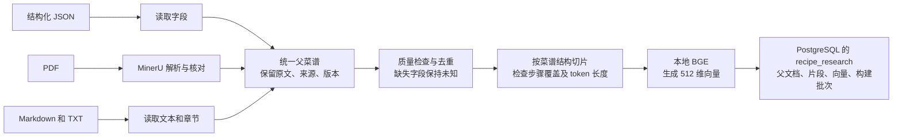
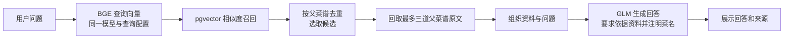
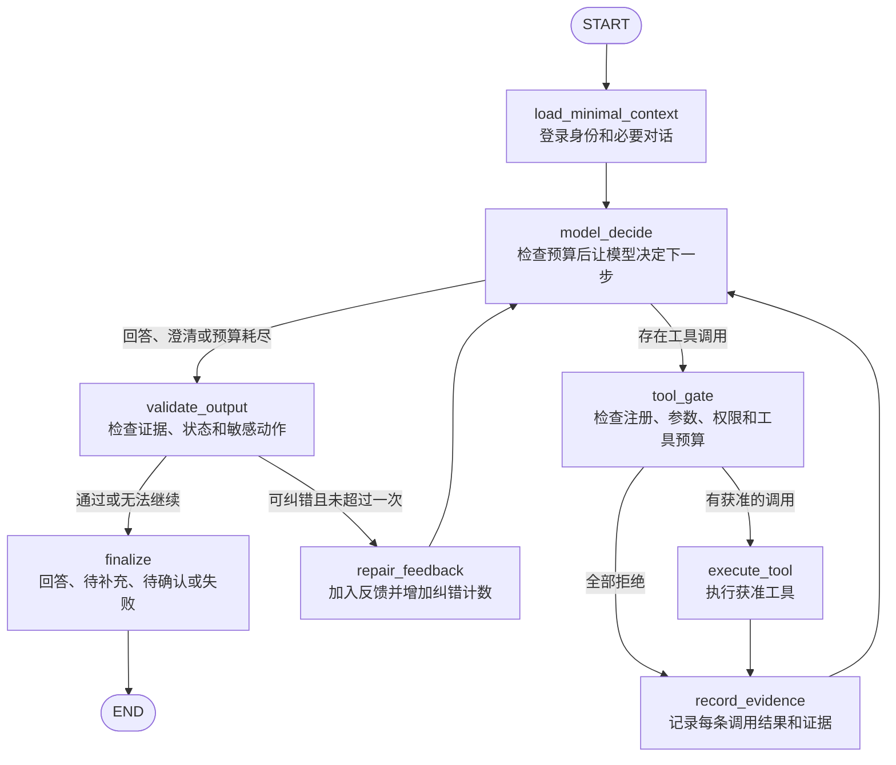
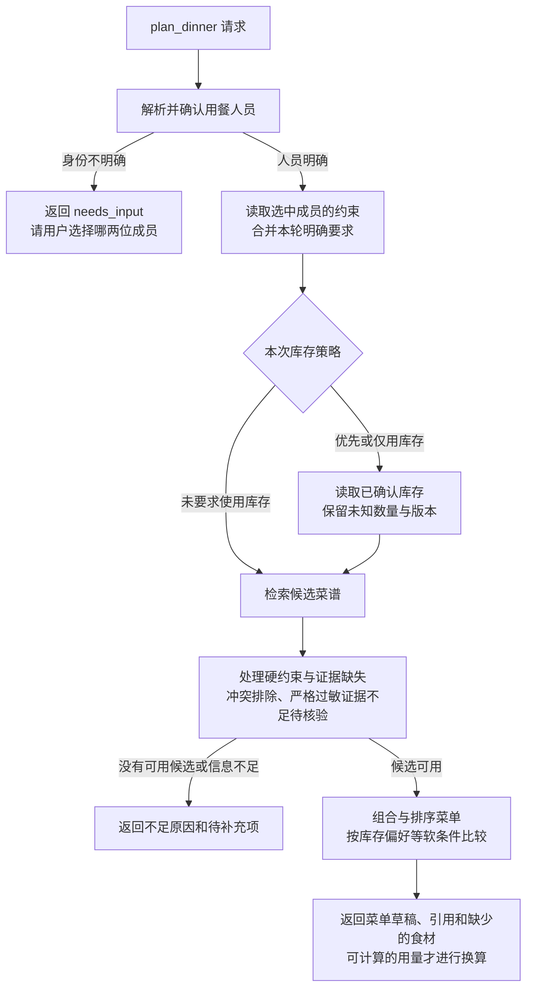

# 智慧冰箱：RAG 与智能体编排设计

> 第一版｜准备日期：2026-11-12｜建议演讲日期：2026-11-13
>
> 听众：老师与技术同学。正文为约 15 分钟可照读讲稿，附录供追问和代码解读。
>
> 汇报主线：**已完成的菜谱 RAG 实践，以及准备建设的家庭助手编排方案。**

## 使用说明与时间安排

正文中的普通段落是讲稿；“演示提示”、图、表和附录用于配合讲述，不必逐字读出。机器视觉部分留给同事补充，不计入这 15 分钟。

文档统一使用三种标记：**【已实现】**表示有现有代码或产物；**【拟设计】**表示本次讨论的目标方案；**【待验收】**表示尚未取得完整验证结果。指标引用已保存的研发报告，不代表本文编写时重新执行了模型或现场演示。

| 时间 | 章节 | 配合展示 |
|---|---|---|
| 00:00—01:30 | 客户与使用场景 | 人员档案、已确认库存 |
| 01:30—02:30 | 技术架构 | 技术职责表 |
| 02:30—06:30 | 已实现的 RAG | 离线、在线两张流程图及数据统计 |
| 06:30—11:00 | 拟设计的 Agent | 外层 StateGraph、配餐子流程 |
| 11:00—13:00 | 演示与场景推演 | 一次终端问答、四类输入路径 |
| 13:00—15:00 | 当前限制与讨论 | 后续验收、交给同事演示视觉 |

## 一、客户、使用者和我们想解决的问题（1.5 分钟）

各位老师、同学好，我今天介绍的是一个智慧冰箱配套助手项目。产品面向国产高端冰箱品牌提供配套 App 和后端服务，真正使用它的是家庭成员。因此，品牌是我们的客户，家庭用户是产品的使用者。

我们想解决的是一个很具体的问题：一家人准备晚饭时，要同时考虑冰箱里有什么、今天谁吃饭、各自有什么忌口，以及这些食材能组合成哪些菜。传统菜谱搜索可以回答“这道菜怎么做”，但用户还得自己把搜索结果与家庭情况对照。

我希望用户可以直接说：“今晚我们两个人吃，尽量用冰箱里的鸡肉，不要花生。”助手能够取得当前家庭的真实资料，找出有依据的候选菜，再解释推荐理由和还缺什么。这里，库存和人员档案是业务事实，菜谱是知识依据，助手负责把它们连接起来。

减少食材浪费和降低晚餐决策成本，是我们希望验证的产品价值。目前还没有实际家庭使用的收益统计，所以今天不报告节省了多少时间或降低了多少浪费。

接下来我重点介绍已经做出的 RAG 基础，以及下一阶段怎样设计 Agent。这次也是一次学习汇报，希望老师帮我判断设计取舍是否合理。

> 演示提示：可展示已有的人员档案与手动库存页面。库存来源讲“用户已确认的信息”；设备拍到的画面不能直接当作准确库存。

## 二、技术架构与职责（1 分钟）

客户端采用 uni-app、Vue 3 和 TypeScript，目标交付是通过 HBuilderX 运行和打包的 Android App，H5 用于开发预览。

后端用 Python 和 FastAPI 提供接口，SQLAlchemy 访问 PostgreSQL，Alembic 管理数据库变更。聊天任务由 API 接收、独立 worker 执行，通过 SSE 返回处理状态和回答。这样模型耗时操作可以独立运行，并支持任务状态和中止处理。

智能体编排使用 LangGraph，检查点使用 PostgreSQL 保存。RAG 的数据加载、切片和检索服务目前主要是自定义 Python 代码，向量模型用 PyTorch 和 Transformers 在本地运行。生成模型通过 OpenAI 兼容 SDK 调用，这里的 SDK 名称不代表一定使用 OpenAI 的模型。

| 层次 | 技术与用途 | 状态 |
|---|---|---|
| App | uni-app、Vue 3、TypeScript、HBuilderX；展示库存、档案和聊天 | 已有页面与接口，部分交互待验收 |
| API 与执行任务 | FastAPI、Pydantic、独立 worker、SSE | 已有基础链路 |
| 业务与状态存储 | PostgreSQL、SQLAlchemy、psycopg、Alembic | 已使用 |
| 编排与检查点 | LangGraph、PostgresSaver | 已有基础图；下文是新目标编排 |
| 向量检索 | PostgreSQL 的 pgvector 扩展、BGE、PyTorch、Transformers | 研发知识库已建立 |
| 文本生成 | OpenAI 兼容 SDK，模型由配置选择 | RAG 终端与 App 使用独立配置 |

> 配置口径：现有 RAG 终端问答读取 GLM 配置，当前为 `glm-4.5-air`；准备文档时 App 对话配置为 `deepseek-v4-pro`，两者不是同一条调用链。模型名可能调整，现场以各自配置为准，展示时隐藏密钥。Python 环境契约为 3.13，项目声明范围为 `>=3.12,<3.14`。

## 三、已经完成的 RAG：从来源文件到有依据的回答（4 分钟）

### 3.1 离线准备：把不同来源变成可检索的知识

RAG 是在回答时取得外部资料，再把相关资料交给模型生成回答。为了做到这一点，我们先建立离线数据流水线。

数据源包含 HowToCook 的清洗版 JSON，以及已有的种子和多格式样本。JSON 本身已有字段，可以直接读取菜名、食材和步骤；PDF 先用 MinerU 解析，检查提取顺序；Markdown 和 TXT 按文本及章节读取。它们不必先全部转换成同一种文件格式，真正需要统一的是解析后的父菜谱结构。



父菜谱是完整的一道菜，切块是为了检索而生成的片段。原文、来源和版本仍然保留，不会只剩下向量，也不会通过向量“解码”回原文。

切片时，短菜谱保留完整的一块；长菜谱拆成基本信息和食材的概览块，以及按顺序组成的做法块。步骤太长时尝试按句子继续拆，并记录它属于原来的哪一步。做法块带菜名和食材上下文，便于单独召回时辨认菜谱。

我们没有对所有内容机械地每隔固定字数切一刀，因为这种做法容易把食材和对应步骤切散。当前策略使用 450 字的初始上限，还用 BGE tokenizer 检查实际 token 长度，避免模型静默截断。切完要能把步骤片段完整拼回原步骤。

目前的统计是：HowToCook 输入 444 条，按菜名、规范化食材和步骤去重，保留 443 条；加上已有 40 条，共 483 条父菜谱。其中 482 条成功切成 741 块。还有一道“牛油火锅底料”未切成功，我在后面解释这个问题。

### 3.2 为什么使用 BGE 和 pgvector

向量化使用本地 `BAAI/bge-small-zh-v1.5`，输出是 512 个数字组成的向量。这个维度不是输入字数，也不是切块数量。查询和文档需要使用兼容的模型配置；查询按模型要求加检索前缀，文档不加，然后进行归一化。

我选择 BGE small 作为当前研发基线，是为了先用较轻的中文模型建立可测量的流程，也方便与同事的实验对照。这个选择还不代表它是最终效果最好的模型。下一步可以在同一套问题和语料上比较 BGE large、Qwen3 Embedding，再看召回质量、延迟和资源占用。

存储方面，pgvector 是 PostgreSQL 的扩展。业务数据和向量数据可以在同一个数据库服务里管理，不需要仅因为有向量就另起一个数据库。我们把当前研发知识放在独立的 `recipe_research` schema，保留原有业务数据和旧演示索引，便于检查和回退。未来是否分库，要看负载、权限、维护和扩容需求。

### 3.3 在线问答：检索片段，回到完整菜谱

在线查询时，先用同一 BGE 模型把问题转成向量，查找相近的菜谱片段，再按父菜谱去重并取回原文。当前终端问答最多选三道父菜谱，把资料与问题一起交给生成模型，并要求注明引用的菜名。



这里有一个重要区分：检索片段帮助我们定位知识，完整父文档帮助模型理解食材和步骤；生成模型负责组织语言，不能凭空补出原文没有的份数、过敏原或用量。

我们已经保存了初步评估。新增 12 道题中，有 11 道标为可回答，其中 10 道在前五个候选里至少命中一道正确菜，Hit@5 是 10/11，约 90.91%。它不是回答准确率，也不表示所有相关菜都找全了。Recall@5 衡量相关菜被找回的比例，这份报告是 84.62%。

这些只是小样本研发结果。当前还保留了关键词检索作为对照，研发链路尚未做真正的两路融合，也没有加入重排模型。后续要通过错例决定哪些步骤值得增加。

> 展示提示：打开数据汇总、切片汇总和评估汇总，不展示密钥或本机私有路径。证据入口见附录 F。

## 四、下一阶段的 Agent：模型选工具，代码落实业务规则（4.5 分钟）

### 4.1 为什么还需要 Agent

上面展示的是固定 RAG 问答：输入问题，先检索，再生成。但智慧冰箱助手还有其他请求。“你好”无需读库存；“冰箱有什么”需要查业务数据；“晚饭吃什么”可能同时需要人员约束、库存和菜谱。

我的新设计是一个单 Agent。给它职责清楚的工具，由模型根据问题和对话上下文决定直接回答、追问还是调用工具。程序规定工具的权限、参数和运行边界。复杂的配餐任务封装为工具，工具内部执行必须完成的业务流程。

这张图是准备实现的目标 StateGraph，不是把终端 RAG 已经接入 App 的证明。App 目前已有基础聊天图，但还没有接到这批 BGE 研发索引。

### 4.2 外层 StateGraph【拟设计】



图里的条件边看的是模型有没有提出工具调用，而不是用代码搜索句子里有没有“冰箱”两个字。比如“你好，冰箱里的鸡肉能做什么”，模型要理解完整请求，不能看到“你好”就结束。

入口只加载可信身份和必要的对话上下文，不因为用户问候就预先读取整份库存、健康备注和人员档案。业务数据按工具需要读取，而且家庭身份来自登录态，不能让模型随便指定另一个家庭。

模型提出调用后，程序校验并执行，再把结果交回模型。模型可以根据结果继续查询，也可以提出澄清问题。工具失败会作为明确结果交回去，不能被当作“库存为空”。循环有模型调用和工具调用预算，预算耗尽时禁止新调用；已经产生的工具请求仍要逐条写回拒绝结果，再结束并说明情况，不无限重试。

回答检查也有边界：代码能核对引用 ID 是否来自本轮证据，能阻止未经确认的写操作，但不能仅靠一个节点证明整段自然语言绝对正确。回答忠实性仍然需要评估与人工抽检。

### 4.3 配餐工具内部的固定子流程【拟设计】



这里，模型选择“配餐工具”，不等于模型可以跳过人员确认或忌口处理。用户说“两个人”时，人数已知，但具体是哪两个人可能仍未知。系统应该先确认，不能擅自选档案。涉及严格过敏限制时，相关原料或过敏原无法核验的菜谱不能当作合格推荐，要进入待核验或信息不足路径。

库存也有不同语义：“尽量用库存”是排序偏好，可以推荐需要少量补买的菜；“只能用现有食材”是更强条件，信息不足时要说明无法确认。不能把食材数量未知当成足够，也不能随口给一个“库存占比 70%”的权重就声称策略合理。

配餐结果先作为草稿返回。如果用户接着要求把缺少的食材加入共享采购清单，助手可以准备草稿，但实际写入需要用户确认，确认时还要重新校验身份和数据版本。

### 4.4 状态在这里起什么作用

State 可以理解成这轮任务的工作记录：用户说过什么，选中了哪些人，查到哪个版本的库存，引用了哪些菜谱，以及还剩多少调用预算。LangGraph 让节点读取和更新这些状态，条件边再依据状态决定下一步。

State 不是真实世界本身。模型说“应该还有两个鸡蛋”，不能因此成为确认库存；数据库快照也可能过期，所以需要保留版本。新的目标图要把模型推断、工具事实和用户确认分清楚。

## 五、两分钟演示：一条真实 RAG 链路和四类目标路径

### 5.1 终端问答【已实现，现场结果需实际运行】

> 演示提示：先展示数据汇总和切片报告，再运行一次终端问答。完整演示只依赖已存在的研发索引，不在台上重新导入、迁移或向量化。

从项目根目录进入后端，在已安装所需依赖的环境里执行：

```powershell
cd apps/api
python -m app.cli.ask_research_recipes --batch-id 286bfcc1-52d1-451c-b126-62295cc22259 --query "番茄炒蛋怎么做？"
```

这个批次 ID 来自既有研发报告。演讲前先确认本机数据库已启动、当前迁移与代码一致、本地 BGE 模型存在，以及 GLM 配置可用。若当前数据批次已更新，须先核对报告再替换 ID。环境准备见 [Windows 依赖与启动手册](../05_Windows依赖与启动手册.md)。

**演示时说：**

现在终端先显示选中的父菜谱、命中区段、相似度和来源，再显示模型回答。我关注的不是它是否背出了番茄炒蛋，而是答案依据能否追溯到这批资料。如果资料没有用量，它应该说明不足；如果检索到了不相关菜谱，这也是需要记录的错误。

本轮是固定 RAG 终端链路。接下来四个场景展示的是新 Agent 图的预期执行轨迹，不是现场已经运行的 App 工具日志。

### 5.2 四类输入的设计推演【拟设计】

| 输入 | 目标路径 | 应观察的行为 |
|---|---|---|
| “你好” | 最小上下文 → 模型 → 回答检查 → 返回 | 不读取库存和饮食档案 |
| “番茄炒蛋怎么做？” | 模型 → 菜谱检索，按需取详情 → 根据证据回答 | 有来源，不编造原文缺失项 |
| “冰箱里还有什么？” | 模型 → 库存工具 → 回答 | 只用当前家庭已确认库存，未知量说明未知 |
| “根据冰箱库存，给我们两个人推荐晚餐” | 模型 → 配餐工具 → 澄清或执行配餐子流程 → 返回草稿 | 先确认人员，约束由代码处理，不自动写采购 |

**演示时说：**

这几个例子走的是同一张外层图。模型决定是否调用工具，工具内部的流程决定怎样完成业务。我们可以记录节点与工具轨迹，检查问候有没有无用查询、配餐有没有漏掉必要资料，而不只看最后一句话是否流畅。

### 5.3 演示失败时的替代讲述

若数据库、模型下载文件、网络或生成服务不可用，停止现场问答，打开附录 F 链接的既有报告，并明确说：

> “现场链路暂时不可用，下面展示的是既有研发批次的保存结果，不是刚才这次问题的实时输出。它能说明我们已经做过哪些验证，不能代替本次现场验收。”

不预写一段“完美回答”冒充模型实时输出。报告中的评估结果也不保证任意现场问题都能正确召回。

## 六、当前限制、下一步和向老师请教的问题（2 分钟）

目前可以确认的是，我们已经完成了一批菜谱的加载、结构切片、真实向量入库、检索评估和终端 RAG 问答。当前研发索引尚未接入 App 的聊天助手，新配餐流程也是准备实现的设计。

数据准备还有一个明确缺口：“牛油火锅底料”有 33 项食材，切片器重复的菜名和食材上下文占了 375 字，第一步本身只有约 75 字，带编号后约 78 字；加上标题后总共 458 字，超过 450 字上限。它说明上下文预算分配有问题，需要给步骤留空间，而不是把这道菜的原步骤说成异常长。

另外，测试中“不要花生”仍可能召回含花生菜谱。语义检索只负责找相近内容，不能代替忌口过滤。现有数据中的份数、过敏原和用时还有大量未知，需要先明确能做什么，不能为了演示完整就补造。

HowToCook 上游公开仓库标注 Unlicense，但这份清洗 JSON 对应的上游版本和处理来源还没有完整登记，当前研发元数据仍保留待审核状态。后续要补来源映射与发布审核。

下一步我准备先完善统一检索服务和评估，再接入目标工具调用图，逐步验收查菜谱、查库存和配餐。约一万条语料是扩展设计目标，我们还没有完成一万条规模的容量验证。

我希望请老师重点点评三个问题：第一，外层工具调用加内层固定配餐流程，是否适合当前业务复杂度；第二，未知过敏原和未知份量应该怎样影响候选资格；第三，应该用怎样的评估门槛，决定何时接入真实用户。

接下来交给我的同事介绍机器视觉部分。视觉观察未来会作为库存候选，经用户确认后再供助手使用；具体识别效果及当前联调程度，请同事基于实际完成情况说明。

## 七、机器视觉演示占位

> **由同事补充，暂留空。** 本文不展开模型、识别指标和演示内容。
>
> 衔接约定：说明视觉演示是独立模块还是已经接入 App；识别结果经过用户确认后，才形成已确认库存。

---

# 技术附录（不计入 15 分钟照读正文）

## A. 为什么这样选：面向老师追问的决策表

| 决策 | 当前理由 | 后续如何判断是否调整 |
|---|---|---|
| JSON 按字段读，PDF 先解析 | 来源结构不同，统一父文档即可；文件格式不需要强行统一 | 检查食材、步骤、顺序和来源是否丢失 |
| 结构切片与父文档回取 | 兼顾按食材找菜、查具体步骤和完整做法 | 查步骤覆盖、召回错例、上下文长度与答案忠实性 |
| 450 字＋实际 token 检查 | 字数是当前策略参数，token 是模型输入边界 | 用评估调整块长，并修复重复上下文预算 |
| BGE small 中文版 512 维 | 本地中文检索的轻量基线，便于与同事对照 | 同语料与问题比较 BGE large、Qwen3 等候选 |
| PostgreSQL＋pgvector | 业务已使用 PostgreSQL，可复用备份、事务和维护能力 | 看负载、访问隔离、扩展与运维需求决定是否分库 |
| 向量与关键词先做对照 | 先知道两路各自哪里有效，再决定融合 | 比较各路与融合后的检索指标和错误类型 |
| 单 Agent＋业务工具 | 当前工具集合有限，直接工具调用足以表达多种请求 | 评估漏调用、多调用、错误参数和端到端成功率 |
| 配餐内部固定流程 | 人员、约束和库存事实存在必须执行的规则 | 集成测试验证缺失信息、冲突、未知量及失败路径 |
| 显式 StateGraph | 节点、状态、条件边可解释、可追踪和持久化 | 检查恢复、取消、预算和证据一致性 |

补充解释：本地运行的是向量模型，终端问答的生成模型通过远程 API 调用。因此不能宣称“整套问答完全离线”。

## B. Agent 的工具边界与输入输出【拟设计】

以下是行为契约草案，不代表这些新接口已经全部实现。

| 工具 | 什么时候使用 | 主要输入 | 返回给模型的内容 |
|---|---|---|---|
| `search_recipes` | 需要菜谱依据或候选 | 问题、可核验的筛选条件 | 文档 ID、片段、来源、版本、数据限制 |
| `get_recipe_detail` | 需要完整食材和步骤 | 搜索返回的文档 ID 与版本 | 父菜谱原文及字段可信程度 |
| `get_inventory` | 用户问当前冰箱，或明确要求按库存找菜 | 食材筛选条件；家庭身份由后端注入 | 已确认食材、数量/未知状态、快照版本 |
| `plan_dinner` | 用户请求为指定成员推荐一餐 | 用餐人员选择、本轮要求、库存策略 | 菜单草稿或待澄清项、证据和限制 |
| `prepare_procurement` | 用户要求准备缺少食材的采购草稿 | 菜单引用和待买项 | 待确认动作 ID 与预览，不直接写共享清单 |

人员选择是配餐的前置环节。可通过有权限的成员选择接口解析用户提到的名字；人数相同不能直接推出人员身份。只把所需成员资料送入相关业务流程，不把全部敏感档案长期塞进每次模型输入。

工具结果统一区分成功、信息不足、无匹配、失败和待确认。拒绝的工具调用也要返回匹配的工具结果，避免对话协议中出现只有调用、没有结果的孤立消息。检索资料是证据，不是能够改变系统规则的指令。

`plan_dinner` 内部先处理硬约束，再比较库存利用、口味和制作负担等软偏好。当前没有验证过的库存权重公式，不应在演讲中声称已经优化。未知过敏原不能被当作“无过敏原”；未知数量不能被当作零或足量。

## C. State 字段与节点职责【拟设计】

| 状态字段 | 含义与更新者 |
|---|---|
| `messages` | 模型和工具消息；节点提交增量，由 `add_messages` 合并 |
| `actor_context` | 后端确认的账号、家庭和会话身份，不由模型指定 |
| `member_selection` | 用户选择/确认的成员及待澄清项 |
| `constraints` | 本轮要求与相关人员的约束，保留依据和未知项 |
| `inventory_snapshot` | 工具返回的已确认库存及版本，按需读取 |
| `evidence` | 文档、片段、版本和来源，用于引用核对 |
| `tool_calls` / `validated_calls` | 本轮工具请求，以及校验后获准执行的请求 |
| `pending_tool_results` | 本轮工具结果，包括拒绝和执行错误，等待追加到消息 |
| `pending_action` | 用户尚未确认的采购等动作草稿 |
| `budget` / `budget_exhausted` | 调用、耗时预算及耗尽状态，由代码更新 |
| `repair_count` | 回答纠错次数，本方案最多一次 |
| `output_status` | 完成、待补充、待确认、需纠错或无法继续 |
| `trace` | 节点与工具轨迹，供排查和评估，不等同模型隐藏推理 |

| 节点 | 必须落实的行为 |
|---|---|
| `load_minimal_context` | 校验会话归属，加载必要历史与可信身份，初始化本轮状态和预算 |
| `model_decide` | 先检查预算，再传入工具说明；返回回答或标准工具调用，每轮刷新调用列表 |
| `tool_gate` | 检查工具、参数、数据访问权限和工具预算；把拒绝结果与获准调用分别保留 |
| `execute_tool` | 只执行获准的请求；配餐交给固定子流程；错误转成明确工具结果 |
| `record_evidence` | 闭合本轮所有工具调用，追加结果消息与可追溯证据，清理暂存结果 |
| `validate_output` | 核对引用与本轮结果、处理待补充/确认状态；不通过时有限纠错 |
| `repair_feedback` | 增加纠错计数，只追加具体问题，不伪造资料 |
| `finalize` | 持久化本轮结果和状态，返回客户端，结束本轮运行 |

等待用户补充或确认时，本轮返回 `needs_input` 或 `needs_confirmation` 并结束。下一条用户消息或确认请求触发新的受控执行；不会在进程里无限等待。确认接口要校验动作归属、版本和重复提交，模型不能代替用户确认。

## D. 手写 StateGraph 的结构示意【拟设计，不是已接入业务的实现】

这段代码表达图结构，使用显式节点、边和条件路由，没有使用预构建 Agent 工厂。实际节点由调用方注入，业务函数、鉴权和持久化实现不在此示意中。即使图能编译，也不等于完成了模型与业务接入。

```python
import operator
from collections.abc import Callable, Mapping
from typing import Annotated, Any, Literal, TypedDict

from langchain_core.messages import AnyMessage
from langgraph.graph import END, START, StateGraph
from langgraph.graph.message import add_messages


class AssistantState(TypedDict, total=False):
    messages: Annotated[list[AnyMessage], add_messages]
    actor_context: dict[str, str]
    member_selection: dict[str, Any]
    constraints: dict[str, Any]
    inventory_snapshot: dict[str, Any]
    evidence: dict[str, Any]
    tool_calls: list[dict[str, Any]]
    validated_calls: list[dict[str, Any]]
    pending_tool_results: list[AnyMessage]
    pending_action: dict[str, Any] | None
    budget: dict[str, int]
    budget_exhausted: bool
    repair_count: int
    output_status: Literal[
        "done", "needs_input", "needs_confirmation", "repair", "unavailable"
    ]
    trace: Annotated[list[str], operator.add]


Node = Callable[[AssistantState], dict[str, Any]]


def after_decide(state: AssistantState) -> str:
    # 决策节点先检查模型预算；若已有工具请求，必须先过门禁。
    # 工具预算不足也由门禁生成匹配的拒绝结果，不能跳过协议闭合。
    return "tool_gate" if state.get("tool_calls") else "validate_output"


def after_gate(state: AssistantState) -> str:
    # 拒绝结果仍需进入消息历史；获准和拒绝的调用都必须有对应结果。
    return "execute_tool" if state.get("validated_calls") else "record_evidence"


def after_validation(state: AssistantState) -> str:
    can_repair = (
        state.get("output_status") == "repair"
        and state.get("repair_count", 0) < 1
        and not state.get("budget_exhausted", False)
    )
    return "repair_feedback" if can_repair else "finalize"


def build_graph(nodes: Mapping[str, Node], checkpointer=None):
    graph = StateGraph(AssistantState)
    for name in (
        "load_minimal_context",
        "model_decide",
        "tool_gate",
        "execute_tool",
        "record_evidence",
        "validate_output",
        "repair_feedback",
        "finalize",
    ):
        graph.add_node(name, nodes[name])

    graph.add_edge(START, "load_minimal_context")
    graph.add_edge("load_minimal_context", "model_decide")
    graph.add_conditional_edges(
        "model_decide", after_decide,
        {"tool_gate": "tool_gate", "validate_output": "validate_output"},
    )
    graph.add_conditional_edges(
        "tool_gate", after_gate,
        {"execute_tool": "execute_tool", "record_evidence": "record_evidence"},
    )
    graph.add_edge("execute_tool", "record_evidence")
    graph.add_edge("record_evidence", "model_decide")
    graph.add_conditional_edges(
        "validate_output", after_validation,
        {"repair_feedback": "repair_feedback", "finalize": "finalize"},
    )
    graph.add_edge("repair_feedback", "model_decide")
    graph.add_edge("finalize", END)
    return graph.compile(checkpointer=checkpointer)
```

节点约定：`repair_feedback` 每次增加 `repair_count`；`model_decide` 和工具执行器在调用前扣减预算；`record_evidence` 只追加本轮消息增量；`finalize` 若纠错仍失败，明确返回不足或失败状态。检查点用于恢复执行，实际写操作仍需幂等控制，不能因为恢复就重复采购。

上图的 `plan_dinner` 是 `execute_tool` 调用的业务能力，可以在内部再实现成子图。外层图无需为问候、查库存、问做法各建立一个独立 Agent。工具多到难以正确选择时，再用评估决定是否增加任务路由。

## E. 常见追问与回答建议

**1. 为什么菜谱是 JSON，还要向量化？SQL 不够吗？**

SQL 适合精确字段筛选和业务事实查询。向量检索补充“怎么让牛肉更嫩”“适合下饭的鸡肉菜”这类语义表达。二者各自发挥作用；菜名精确匹配不必绕远路，库存也不能靠语义相似度猜。

**2. 向量检索返回的是数字，怎么变回文字？**

每个向量与片段 ID、片段原文、父文档 ID 关联。相似度计算得到命中 ID 后，程序读取对应原文，不需要把向量反解成文字。

**3. 为什么不是直接上更大的向量模型？**

当前 BGE small 是可测量的基线。模型大小、向量维度、输入长度是不同概念。升级要看同一批问题上的检索收益与资源代价，不能只看维度。

**4. 你这个是 Agent 还是 Workflow？**

外层由模型动态选择工具，属于 Agent；工具内部用确定步骤完成配餐，属于 Workflow。整体是包含业务工作流的单 Agent 系统。“AI Native”是产品描述，不能代替具体控制流说明。

**5. 为什么不用多 Agent？**

当前业务工具数量有限，一个 Agent 已能协调。多 Agent 会增加消息传递、状态协调和评估成本，暂时没有证据表明它能改善当前任务。

**6. 所有判断都交给模型了吗？**

模型理解语义并提出行动。代码控制权限、参数、预算、业务约束和确认写入；工具结果提供事实。对于必须检索才可回答的场景，要通过执行检查和测试降低漏调用，而不只依赖一句提示词。

**7. Hit@5 90.91%，是不是用户问题九成都能答对？**

不是。这是 11 道可回答研发题里，10 道前五候选至少命中一道正确菜。它不衡量回答是否忠实，也不能代表所有用户问题。还需扩大和人工核对标注，分别评估检索与回答。

**8. 一万条数据还能这样做吗？**

父文档、批次和分批向量化的设计可以延用，但要测内存、构建耗时、查询延迟和并发。当前候选集合规模没有达到一万条，不能称为已经完成容量验证。

**9. 两人份、过敏和冰箱匹配怎么保证？**

只在份数和食材用量有可靠依据时换算；对相关人员的明确忌口执行过滤；过敏原未知时不宣称安全；库存数量未知时只说明可见食材，不能精确计算缺口。这些是拟实现配餐流程的验收条件，当前向量检索尚未完成这些能力。

**10. 怎样测试模型是否正确调用工具？**

建立有预期行为的场景集：纯问候不调用业务工具；“你好，鸡肉能做什么”不能误判为纯问候；查库存必须取得当前数据；人员不明会澄清；工具失败不能编造结果。分别统计必要工具漏调用、无用调用、跨家庭访问、约束违规和端到端任务成功率。

## F. 实现状态与证据入口

以下链接均为仓库相对路径，不含个人环境路径和密钥。

| 能力 | 准备文档时的状态 | 证据 |
|---|---|---|
| 当前产品定位与功能边界 | 已记录；README 部分模型默认描述可能滞后于本机配置 | [文档入口与当前决策](../README.md) |
| 444 → 443，加 40 条得到 483 条父文档 | 已生成研发产物 | [加载汇总](../../output/howtocook-research-v1/summary.json) |
| 482 道成功、741 块；1 道失败 | 已生成研发产物 | [切片汇总](../../output/recipe-research-chunks-v1/summary.json)、[失败清单](../../output/recipe-research-chunks-v1/issues.jsonl) |
| 结构切分、字数/token 边界、步骤覆盖 | 已有实现 | [研发切片器](../../apps/api/app/services/research_chunks.py) |
| BGE 编码、归一化、批次与单路检索 | 已有研发实现 | [研发索引服务](../../apps/api/app/services/research_index.py) |
| 父文档、512 维向量及 HNSW/GIN 索引 | 已有迁移和构建记录 | [隔离索引迁移](../../apps/api/migrations/versions/l7a8b9c0d1e2_recipe_research_staging.py)、[开发记录](../开发用例/20261110-0008-howtocook-research-index.md) |
| 检索 → 父文档 → GLM 问答 | 终端代码已有，现场演示另行实际运行 | [问答入口](../../apps/api/app/cli/ask_research_recipes.py) |
| 12 道新增题的检索评估 | 已保存的小样本结果 | [问题集](../../data/eval/recipe_research_howtocook_v1.jsonl)、[评估汇总](../../output/recipe-research-eval-v1/howtocook-questions/summary.json) |
| 当前 App 的基础工具循环 | 已有旧实现；未接入 BGE 研发索引 | [当前 Graph](../../apps/api/app/agent/durable_graph.py) |
| 统一融合检索、新目标图、库存配餐与新引用闭环 | 拟设计，尚未完成端到端验收 | 本文第四节及附录 B—D |
| 机器视觉 | 本文留空；App 设备与视觉服务接入不作已完成声明 | 由同事说明实际演示范围 |

**既有研发统计快照：**批次 `286bfcc1-52d1-451c-b126-62295cc22259`，记录为 741 条 512 维向量、覆盖 482 道菜，`production_publishable=false`。该数字来自已保存记录，现场应核对实际数据库；加载和切片报告中的 `embedding_performed=false` 只描述各自阶段，不表示后续向量化没有执行。

**发布与来源：**[HowToCook 上游](https://github.com/Anduin2017/HowToCook)有 [Unlicense](https://github.com/Anduin2017/HowToCook/blob/master/LICENSE)；当前清洗文件清单仍标注 `unverified`，需要补齐上游版本及清洗来源映射，不把“公开可见”直接当成这份派生文件已经完成发布审核。

## G. 演讲前检查清单

- 用 Markdown 预览确认四张 Mermaid 图能显示；演讲时优先展示已渲染图。
- 通读正文计时，附录不全部展开，给现场问答留出弹性。
- 提前确认演示环境、数据库、迁移状态、BGE 模型与生成服务可用；运行只读问答，不临场迁移或改数据。
- 生成 API 会发送选中的菜谱资料到配置的服务；不要把真实家庭敏感信息加入这次菜谱演示。
- 本地原始数据、模型权重和部分完整结果文件不随仓库分发，换机器演示需要另行准备。
- 把输出截图或保存报告作为备用，并标明原始批次；不把备用内容称为现场执行。
- 与同事确认机器视觉的衔接句、操作顺序和已联调范围，避免两人对同一能力给出不同完成状态。
