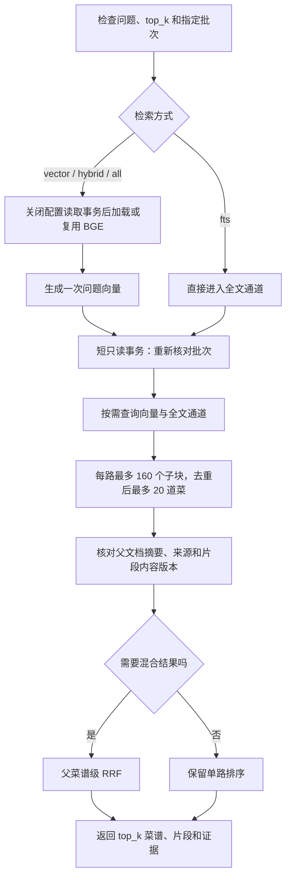

# 菜谱统一检索器使用说明

当前状态：统一检索器已在后续工具封装中补充功能与独立 PostgreSQL SQL 测试；**检索效果评估尚未完成**。本说明中的命令和代码是使用方法，不是评估报告。测试范围与工具接入边界见 [助手工具封装与重建说明](助手工具封装与重建说明.md)。

## 1. 这一步解决什么问题

离线准备阶段已生成菜谱子块和向量。本轮增加一个可复用的读取入口：输入问题，输出候选菜谱和片段证据。调用者可以选择三种检索方式，不必分别组织向量查询和全文查询。

检索器不生成答案，不自动判断候选一定相关，也不完成配餐。App、Agent 和生成问答入口本轮均未接入。

| 方式 | 如何召回 | 依赖 | 分数含义 |
| --- | --- | --- | --- |
| `vector` | BGE 问题向量与 pgvector 中的片段向量计算余弦距离 | 本地 BGE、torch、transformers、数据库 | `cosine` 越大越相似 |
| `fts` | jieba 分词，PostgreSQL `simple` 全文查询匹配片段 | jieba、数据库；不加载 BGE | `ts_rank` 是全文排序分数 |
| `hybrid` | 两路独立召回，按父菜谱名次做 RRF 融合 | 两路所需依赖 | `rrf_score` 是融合排序分数 |

这里的全文检索使用 `plainto_tsquery`、`@@` 和 `ts_rank`，**不是 BM25**。三类分数都不是正确概率，也不能把余弦分数与全文分数直接相加。

## 2. 代码在哪里、按什么顺序阅读

所有路径相对于仓库根目录。

1. `apps/api/app/services/research_retrieval.py`：统一服务。先看 `search` / `search_all`，再看 `_search` 的执行顺序；`_batch` 检查配置，`_embed` 负责问题向量化，`_verify_evidence` 检查版本，`_results` 整理证据及融合结果。
2. `apps/api/app/services/research_index.py`：复用 BGE 编码和底层 `search_parents` SQL；全文通道增加真实匹配、正分数过滤，查询增加稳定排序及可选父文档数据返回。
3. `apps/api/app/services/hybrid_retrieval.py`：复用纯函数 `reciprocal_rank_fusion`；本轮没有使用其中的 `fake_embedding`。
4. `apps/api/app/cli/search_research_recipes.py`：终端单次查询调用统一服务；原有问题集评估函数保留。

当前内容版本重算复用 `chunk_recipe_parents.py` 的渲染与摘要函数，与建库规则保持一致；没有再次切分文档。未来切片规则变化时，需要一起更新版本检查，不能仅把新规则名加入允许列表。

## 3. 服务接口

从 `apps/api/` 的 Python 环境调用，示意：

```python
from app.cli.register_recipe_sources import ROOT
from app.core.config import get_settings
from app.services.research_index import make_engine
from app.services.research_retrieval import RecipeRetriever

engine = make_engine(get_settings().database_url)
try:
    retriever = RecipeRetriever(
        engine=engine,
        model_dir=ROOT / "models/bge-small-zh-v1.5",
        batch_id="286bfcc1-52d1-451c-b126-62295cc22259",
    )
    result = retriever.search(
        query="鸡肉怎么做得嫩一点？",
        top_k=5,
        mode="hybrid",
    )
    # 复用同一个实例，后续查询无需再次加载 BGE。
    # result = retriever.search("番茄炒蛋", mode="vector")
finally:
    engine.dispose()
```

批次 ID 示例来自既有研发索引记录，不表示本轮核验了数据库当前状态。运行前应自行确认 `.env` 中的 `DATABASE_URL` 和目标批次。`make_engine` 保留现有研发数据库限制，不会绕过写入保护。

构造函数本身不连接数据库、不加载模型；首次向量或混合查询时才加载 BGE。`fts` 不访问本地模型目录，不要求安装 torch / transformers。常规依赖按仓库命令安装：

```powershell
python -m pip install -e ".\apps\api[dev]"
```

本地向量检索另外需要 torch、transformers 和 `models/bge-small-zh-v1.5` 模型文件，沿用现有环境，本轮没有安装依赖或修改依赖声明。同步实例适用于目前终端调用；并发服务的实例管理、推理资源限制与超时策略待接入阶段处理。

## 4. 终端使用

在 `apps/api/` 下执行。以下任选一条；本轮没有执行这些命令。

```powershell
# 默认 all：共用一次问题向量化，展示 vector、fts、hybrid。
python -m app.cli.search_research_recipes --batch-id 286bfcc1-52d1-451c-b126-62295cc22259 --query "番茄炒蛋"

# 只运行全文检索，不加载 BGE。
python -m app.cli.search_research_recipes --batch-id 286bfcc1-52d1-451c-b126-62295cc22259 --query "番茄炒蛋" --mode fts

# 只看向量结果。
python -m app.cli.search_research_recipes --batch-id 286bfcc1-52d1-451c-b126-62295cc22259 --query "鸡肉怎么做得嫩一点？" --mode vector

# 混合检索，最多展示 5 道父菜谱。
python -m app.cli.search_research_recipes --batch-id 286bfcc1-52d1-451c-b126-62295cc22259 --query "鸡肉怎么做得嫩一点？" --mode hybrid --limit 5
```

| 参数 | 默认与限制 |
| --- | --- |
| `--batch-id` | 必填；固定批次，不自动挑“最新” |
| `--query` | 非空；去除首尾空白后最多 500 个字符 |
| `--limit` / 服务 `top_k` | 默认 5；整数 1～20 |
| `--mode` | 单次查询默认 `all`；可选 `vector` / `fts` / `hybrid` / `all` |
| `--model-dir` | 默认仓库 `models/bge-small-zh-v1.5`；相对路径以仓库根目录解释 |

服务的 `search` 默认 `hybrid`，不接受 `all`；三路展示使用 `search_all`。CLI 的 `--mode` 仅用于单次查询，与 `--questions` 同用会报参数错误。原有 `--questions` 和 `--report-dir` 入口未增加混合评估，也未执行。

## 5. 实际数据流



每条通道查询都先按片段分数排序，再按父文档 ID、片段 ID 处理同分，最多读取 160 个子块。每道菜只保留该路得分最高的片段，最多保留 20 道父菜谱。去重后不足 20 道时不会继续分页补足。

混合排序公式：

```text
RRF(菜谱) = Σ 1 / (60 + 该菜谱在对应通道的父菜谱名次)
```

两路等权，各路同一道菜只贡献一次名次；只命中一路也可以进入混合候选。融合分数相同时按父文档 ID 稳定排序。默认最后保留 5 道菜。

`all` 在一个只读、可重复读事务快照中取得两路候选，再同时生成单路与混合视图；不是分别运行三次检索。模型加载、编码均在事务外，避免推理期间占用事务。

## 6. 返回内容怎么读

单次服务结果包含 `mode`、`status`、`hits`；`all` 包含 `vector`、`fts`、`hybrid` 三个列表和各自 `statuses`。空列表只表示对应通道没有召回候选，不表示发生了故障，也不表示系统证明知识库没有答案。

公共元数据包含：

- `index`：固定批次 ID、语料摘要、切片文件摘要、模型名称、维度、查询前缀、归一化配置、切片规则和批次状态。
- `candidate_counts`：每路在 160 块中去重后实际保留的父菜谱数，最多 20；不是数据库总匹配数。
- `candidate_limit_per_channel`、`chunk_limit_per_channel`、`rrf_k`：本次候选预算与融合参数。
- `timing_ms`：总耗时、模型加载或缓存检查耗时、问题编码、各路查询及结果组装耗时。总耗时还包含配置读取和证据核对，不能直接当成线上性能结论。

每个命中项包含：

- `document_id`、`name`、最终 `rank`：研发父菜谱身份和排序，不是业务菜谱表外键。
- `source_asset_key`、`source_record_key`、`source_sha256`、`source_kind`、`source_version`：来源定位与摘要；未知字段保持空值。
- `content_version`：建库时渲染的菜谱内容摘要；`parent_sha256` 是整个父文档 JSON 的摘要，二者含义不同。
- `policy_version`、`batch_id`：切片规则和索引批次。
- `channels`：本结果对应通道的名次、原始分数、分数类型、片段原文、片段 ID、章节、步骤编号及内容版本。混合结果保留两路证据；单路只显示本路。
- `snippet`：用于展示的主片段，选择通道名次较好的证据，同名次优先向量通道；不拼接、改写或生成原文。
- `rrf_score`：仅混合结果有值，单路为 `null`。

片段不是整道菜的完整原文。后续生成答案若需要完整步骤，仍需单独设计按父菜谱取回详情的接口。

## 7. 错误与版本边界

输入错误抛 `ValueError`。操作故障抛 `RetrievalError`，可通过 `code` 区分：

| code | 含义 |
| --- | --- |
| `index_config` | 批次不存在、状态不允许、配置不匹配或切片规则不支持 |
| `model_config` | 本地模型或依赖缺失、加载失败、模型配置不匹配 |
| `embedding_failed` | 问题编码失败 |
| `database_failed` | 数据库连接或 SQL 执行失败；终端不打印底层连接参数 |
| `database_config` | CLI 初始化时数据库驱动缺失或连接 URL 无效 |
| `evidence_mismatch` | 父文档结构、摘要、来源或片段内容版本不一致 |

CLI 失败退出码为 2，并向标准错误输出原因；不会自动改用其他通道，不会用空命中掩盖故障。向量问题超过模型 token 上限时报告输入错误，不静默截断。

检查模型名称、512 维、查询前缀、指令版本和归一化配置；仅“同维度”不足以复用索引。现有批次没有保存模型权重指纹，因此这些检查不能证明本地权重逐字节等同于建库时文件。

现有父文档表存当前版本，没有按批次保存不可变父文档快照。本轮重算渲染摘要可阻止“正文已变但片段未更新”的混用，并核对当前来源字段与当前父文档一致；无法凭现有表结构完全追溯仅来源元数据发生变化的历史。未来正式发布需要不可变快照或批次到父版本的关联，本轮不改表、不重建索引。

## 8. 已知限制与后续工作

- `plainto_tsquery` 对分词后词项采用 AND 语义。较长口语问题可能因部分词项未出现而召回为空；当前不做查询改写、同义词扩展或停用词策略调整。
- 向量通道只按相似度取候选，没有相关性阈值；即便有结果，也不能自动认定能回答。
- 未实现过敏原或忌口硬过滤、人员约束、库存优先级、重排模型、回答生成和来源引用展示。
- 尚未验证 pgvector 近似索引的召回覆盖与本轮新查询的执行计划，没有性能或效果结论。
- 底层全文查询现已过滤不匹配与零分记录；即使原有评估函数未改，未来重跑的结果也不能不注明改动就与历史报告直接比较。
- 本轮不修改语料、向量、业务表、发布状态、迁移、Agent 或 App；不新增评估报告。

接下来应另行安排运行验证与检索评估，再决定是否调整参数、引入查询改写或重排，以及如何接入问答和 Agent。不能仅凭实现完成就宣称混合检索更好或已达到正式接入标准。
